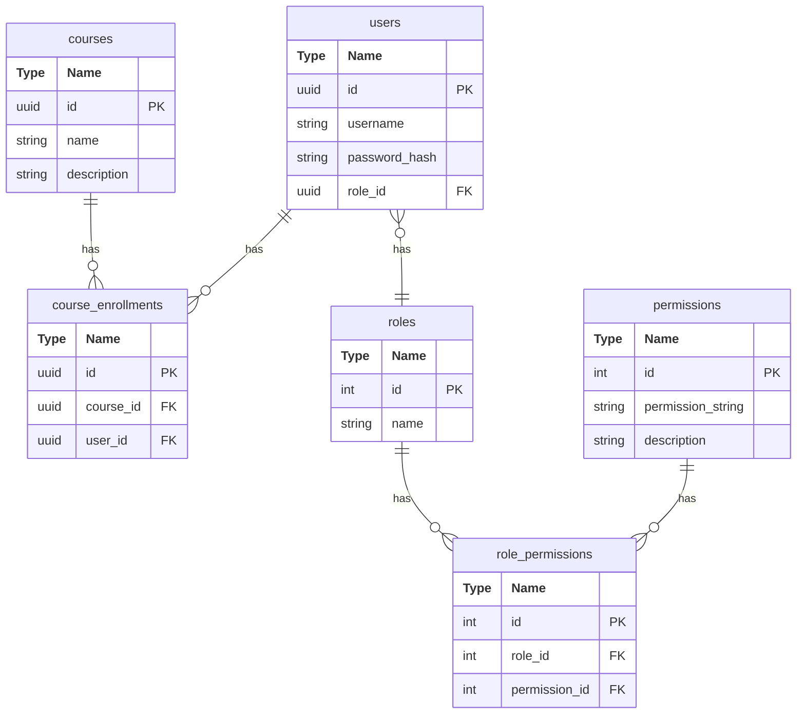

# Fathom LMS

## Purpose
To provide a secure system
* for Students to look at courses and enroll
* for Teachers to manage courses

# Technologies used

**Frontend** 
* **Framework**: ReactJS

**Backend** 
* **Framework**: Django
* **Authentication**: dj-rest-auth
* **User Roles**: django-role-permissions

**Database**: SQLite   

# How to start

**Frontend**: 
Run Local: ```npm run dev```
Local Host: ```http://localhost:5173/```

**Backend**: 
Activate venv ```main-venv/Scripts/Activate.ps1```
Run Local ```python manage.py runserver```
Local Host: ```http://127.0.0.1:8000/```

# If theres a database schema change
1. ```python manage.py makemigrations```
2. ```python manage.py migrate```

# Testing

## Backend
* ```python manage.py test``` to run all tests
* ```python manage.py test {appName}``` to test a specific app

# Database Structure


# Available Backend Commands

**To Run Commands** - ```python manage.py {command_name}```
* **seed_users** - seeds the data base with a user from each role

# Api Endpoints
/api/   rest_framework.routers.APIRootView      api:api-root
/api/<drf_format_suffix:format> rest_framework.routers.APIRootView      api:api-root
/api/courses    api.views.CourseListCreateView  api:course-list-create
/api/courses/<int:pk>   api.views.CourseDetailView      api:course-detail
/api/courses/<pk>/enroll/       api.views.EnrollmentActionViewSet       api:enrollment-actions-enroll
/api/courses/<pk>/enroll\.<format>/     api.views.EnrollmentActionViewSet       api:enrollment-actions-enroll
/api/courses/<pk>/unenroll/     api.views.EnrollmentActionViewSet       api:enrollment-actions-unenroll
/api/courses/<pk>/unenroll\.<format>/   api.views.EnrollmentActionViewSet       api:enrollment-actions-unenroll
/api/me/courses api.views.EnrolledCoursesView   api:user-courses
/api/users/     rest_framework.routers.APIRootView      users:api-root
/api/users/     users.views.UserViewSet users:users-list
/api/users/<drf_format_suffix:format>   rest_framework.routers.APIRootView      users:api-root
/api/users/<pk>/        users.views.UserViewSet users:users-detail
/api/users/<pk>/approve/        users.views.UserViewSet users:users-approve
/api/users/<pk>/approve\.<format>/      users.views.UserViewSet users:users-approve
/api/users/<pk>/reject/ users.views.UserViewSet users:users-reject
/api/users/<pk>/reject\.<format>/       users.views.UserViewSet users:users-reject
/api/users/<pk>\.<format>/      users.views.UserViewSet users:users-detail
/api/users/\.<format>/  users.views.UserViewSet users:users-list
/api/users/auth/registration/student    users.views.StudentRegisterView users:student-register
/api/users/auth/registration/teacher    users.views.TeacherRegisterView users:teacher-register
/api/users/authlogin/   dj_rest_auth.views.LoginView    users:rest_login
/api/users/authlogout/  dj_rest_auth.views.LogoutView   users:rest_logout
/api/users/authpassword/change/ dj_rest_auth.views.PasswordChangeView   users:rest_password_change
/api/users/authpassword/reset/  dj_rest_auth.views.PasswordResetView    users:rest_password_reset
/api/users/authpassword/reset/confirm/  dj_rest_auth.views.PasswordResetConfirmView     users:rest_password_reset_confirm
/api/users/authtoken/refresh/   dj_rest_auth.jwt_auth.RefreshViewWithCookieSupport      users:token_refresh
/api/users/authtoken/verify/    rest_framework_simplejwt.views.TokenVerifyView  users:token_verify
/api/users/authuser/    dj_rest_auth.views.UserDetailsView      users:rest_user_details
/api/users/constants    users.views.UserConstantsView   users:user-constants
/api/users/permissions  users.views.UserPermissionsView users:user-permissions

# Future Improvements 
